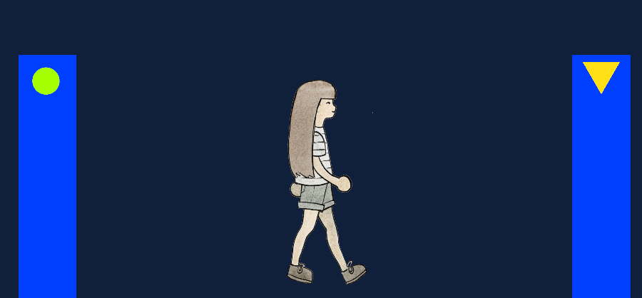
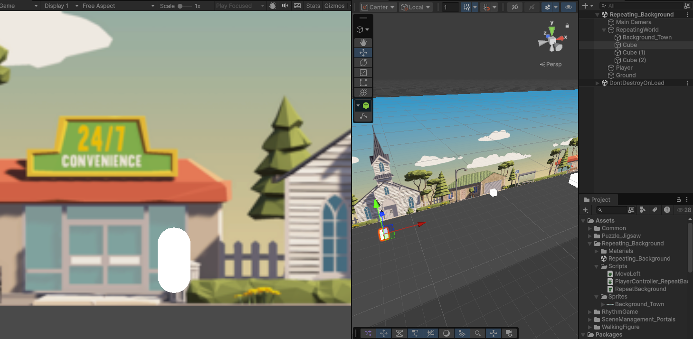

# Art for Games

Examples for DIG 255 Art for Games

## Scene Management ("portals")

- Reusable scripts with parameters set in inspector
- Using reusable prefabs with colliders ("portals") to move between scenes

## Repeat Background

## UI Examples

Trigger text from colliders

